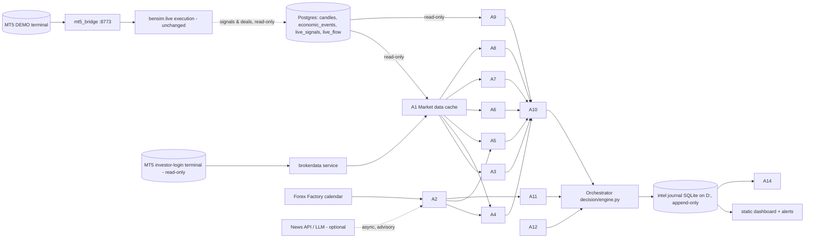

# Bensim multi-agent intelligence: Stage 1 audit and Stage 2 design (2026-11-06)

Design only. Nothing has been implemented, no engine was restarted, and no permissions, risk settings or live logic changed. Everything below waits for your approval.

**Starting point:** Round 3 found no statistically defensible directional edge. The design therefore puts the "know when NOT to trade" layer first. Positive entries come only from strategies that are already approved, or from shadow candidates that pass their forward test.

---

## 1. Existing architecture assessment

### Host (measured 2026-11-06 ~11:00 UTC)

| Resource | Value | Implication |
|---|---|---|
| CPU | i7-6700, 4 cores / 8 threads, ~43% load now | Budget at most 1 extra core on average for intelligence work |
| RAM | 31.9 GB, 12.6 GB free | Intelligence worker ≤ 1.5 GB; research jobs ≤ 6 GB, one at a time |
| GPU | RX 580 4 GB, no CUDA | Not used for trading ML (tree models run on CPU) |
| Disk | **C: 1.6 GB free (critical, Postgres/Docker lives there)**, D: 44 GB, E: 129 GB | All new data on D:/E:. **Risk:** Postgres can fill C: and stop every component |
| Running | 2 MT5 terminals, mt5_bridge (:8773), bensim.live, gf TradeGuard, Docker Postgres (~1 GB), shadow v0.1 (phase13/20 `-m shadow run`, since 11-04), Phase-3 quote sampler (until 11-17) | The execution chain is already heavy and must keep priority |
| Leftovers | 3 orphaned `multiprocessing` workers (~26 MB each) from a research run I stopped on 11-05 | Harmless; kill with your OK |

### Code: three layers already exist

| Layer | Where | State |
|---|---|---|
| **Execution** (orders) | `OpenTerminalUI/bensim`: `live.py`, `bridge.py`/`mt5_bridge.py`, `guard.py`, `books.py`, `flow_live.py`, `news_block.py`, `tradeguard.py`, `manager.py` | LIVE on DEMO 53007035 with 9 strategies. Mapped in `docs/audit/BENSIM_COMPLETE_SYSTEM_AUDIT_2026-11-03.md` |
| **Intelligence and governance** (phases 5–24) | `bensim_phase20_dev` (the latest copy; also phase13/16 and `bensim_intelligence`): `market_intel/`, `decision/`, `risk/`, `shadow/`, `fwd/`, `ops/`, `dataint/`, `brokerdata/` | Built and tested (23 test files, ~5.3k lines). **Not connected to live.** Shadow v0.1 runs observe-only |
| **Research** | `OpenTerminalUI` research scripts, `reports/round3/`, `validate.py`, `registry.py`, strategy library and evidence registry (`decision_dev.sqlite`) | Offline |

### What exists for each requested agent

| Requested agent | Already built (reuse) | Gap |
|---|---|---|
| 1 Market data | `market_intel/data.py`, `quality.py` (gaps, duplicates, abnormal prices, stale data), `dataint/quotes.py` (quote validation, point-in-time ledger), `brokerdata/service.py` (read-only investor-login quotes and M5 bars) | One shared cache that every agent reads; broker **symbol specifications** (the bridge has no `/symbol` endpoint) |
| 2 News | `market_intel/news.py` (`EventSource` protocol, UNKNOWN after coverage ends), `calendar_store.py` (point-in-time calendar), `ops/calendar_cache.py` (rate-limit-safe Forex Factory fetching), live `news_block.py`; FF history 2007–2026 in Postgres `economic_events` | Unstructured-news provider (Grok or other) behind one interface; affected-currency / surprise classification |
| 3 Pip and cost | `risk/engine.py` `Instrument`, `size_lots` (spread + round-trip commission, explicit FX conversion, rounded down to the lot step); `market_intel/spread_model.py` (prepared, **not calibrated**: needs the Phase-3 sampler data after 11-17); `cost_snapshot.py`; R3 cost model | Swap/rollover and slippage terms; break-even price; an expected-net-after-cost function |
| 4 Volatility | `market_intel/volatility.py` (closed bars, multi-timeframe) | The expected-move model (R3: out-of-sample IC 0.34), frozen and versioned |
| 5 Regime | `market_intel/regime.py` + `persistence.py`, validated (`phase4_validate.py`, `validate_history.py`) | None for classification. R3: regime gave no direction value, so it is used for context and sizing only |
| 6 Currency strength | Partial inside `context.py`/`regime.py`; R3 `r3_build.currency` (8-currency ranks) | A standalone module; the model-based ranking (shadow candidate C1) |
| 7 Market structure | `market_intel/structure.py` (confirmed swings, HH/HL/LH/LL, BOS/CHoCH, S/R), which **reuses** `bensim.indicators` (byte-identical to the live copy) | One implementation. A drift-guard test fails if the two copies diverge (`tests/test_skills.py`) |
| 8 Liquidity and imbalance | `indicators.fvgs` / `equal_levels` / `day_levels`; R3 `r3_build` (weekly and London levels, first-of-day sweeps, failed breakouts, first FVG retest, all truncation-tested); `market_intel/liquidity.py` (spread side) | One liquidity skill module built from these (no rewrite) |
| 9 Strategy intelligence | `decision/library.py` (versioned, insert-only, promotion needs evidence + a human approval file), `evidence.py`, `decision/shadow.py` (replays the books' recorded signals), live tables `live_signals*`, `live_flow` | Per-strategy live P&L **by position ID** (manual closes come back as magic 0); a signal-conflict view |
| 10 Opportunity | R3 scoring prototype (`r3_ml.py`: E[net], P(target)/P(stop), TRADE/MONITOR/REJECT) | Productionise as **veto/advisory only** (R3: REJECT band reliably negative; TRADE band not significant) |
| 11 Risk | `risk/engine.py`: 15 checks, pure, `UNKNOWN → WAIT`, never "zero risk"; live `guard.py`; TradeGuard; `risk/flow.py` (risk-based flow sizing, not deployed); F03 package | Integration is designed (`demo_candidate`, `RISK_ENGINE_INTEGRATION.md`) and waiting for your approval |
| 12 Portfolio | Risk checks 11 (currency exposure) and 14 (duplicate/existing position); live one-trade-per-pair rule | Aggregated exposure report across books and accounts |
| 13 Research | `validate.py` (PSR, DSR, bootstrap, PBO, Holm), `registry.py`, round 1–3 scripts, PREREG discipline | A scheduler with resource limits; the forward monitors for the four R3 candidates |
| 14 Performance | `fwd/metrics.py`, `fwd/gates.py`, `fwd/integrity.py`, `shadow/report.py` | The same metrics on the **live** account per book (read-only) |
| Orchestrator | `decision/engine.py` (pure, 6 gates, default WAIT, first non-PASS gate decides, no LLM can pass a gate); `shadow/engine.py` runner; `shadow/journal.py` (append-only, tamper-evident); `shadow/netguard.py` (outbound allowlist) | Wiring in the new specialist outputs through one contract (§6) |
| Dashboard | `shadow/report.py` (static HTML), `ops/health.py` (one health check over every component), `ops/alerts.py` (deduplicated) | One combined page: real vs shadow positions, exposure, decisions |

**Conclusion:** about 70% of the brief exists. The work is to consolidate, fill six gaps (symbol specifications, cost terms, expected move, currency strength, liquidity module, news provider) and wire it all as a **shadow-first sidecar**. A rewrite is not needed.

---

## 2. Proposed agent hierarchy

"Agent" here means a deterministic Python worker with a structured output. Only the News agent may call an LLM, asynchronously, and only for interpretation.

```
                         ORCHESTRATOR (decision/engine.py, pure rules, default WAIT)
                                   │  requests · collects · resolves · records
   ┌─────────── L1 DATA ───────────┼──────────── L2 MARKET ANALYSIS ─────────────┐
   │ A1 Market Data (cache+quality)│ A3 Pip & Cost   A4 Volatility/Expected move │
   │ A2 News (calendar + optional  │ A5 Regime       A6 Currency strength        │
   │    LLM interpreter, async)    │ A7 Structure    A8 Liquidity & imbalance    │
   └───────────────────────────────┼─────────────────────────────────────────────┘
        L3 STRATEGY: A9 Strategy registry/signals · A10 Opportunity (veto score)
        L4 RISK:     A11 Risk engine (15 checks) · A12 Portfolio exposure
        L5 OFFLINE:  A13 Research/backtest (scheduled) · A14 Performance monitor
                                   │
                    EXECUTION GATEWAY (existing bensim.live + guard + bridge)
                    — the ONLY component that can send orders; unchanged in this plan
```

---

## 3. Skills registry (deterministic; reuse first)

| Skill | Source (existing) | New / changed |
|---|---|---|
| pip size, tick size/value, contract size, lot step | `risk/engine.Instrument` (from broker spec) | Read-only spec fetch from the broker data service (`symbol_info`: `trade_tick_size`, `trade_tick_value`, `trade_contract_size`, `volume_step/min/max`, `swap_long/short`, `swap_mode`, digits) |
| account-currency conversion | `risk/engine` (explicit rates, missing → UNKNOWN) | — |
| lot sizing incl. spread + commission | `risk/engine.size_lots` | — |
| spread (bp/pips, per hour) | `market_intel/spread_model.py`, `liquidity.py`, R3 observed spreads | Calibrate after 11-17 (D1 approval item) |
| swap / rollover, slippage, break-even, expected net | partly in R3 cost model | **new** `cost.py` (§9) |
| ATR, realised vol, BB width, compression, vol percentile | `market_intel/volatility.py`, `indicators.atr_n`, R3 `r3_build` | — |
| expected move (bp, 6/12/24h) | R3 HGB move model | **new**, frozen version id |
| regime + persistence | `market_intel/regime.py`, `persistence.py` | — |
| sessions / DST / holidays | `market_intel/sessions.py`, `market_calendar.py` | — |
| currency strength (8 ranks; momentum + model) | R3 `r3_build.currency` | **new** module (copied, tested) |
| swings, HH/HL, BOS/CHoCH | `market_intel/structure.py`; `indicators.structure` | Parity test only |
| FVG, EQH/EQL, PDH/PDL, Asian/London/PW levels, sweeps, failed breakouts, first retest | `indicators.*`, R3 `r3_build` | **new** `liquidity_levels.py` assembled from these |
| correlation / exposure | risk check 11 | Portfolio aggregation |
| statistics (week-clustered t, BH, PSR/DSR, bootstrap) | `validate.py`, R3 harness | — |

Every skill gets the same truncation (no-look-ahead) test that R3 uses.

---

## 4. Agent responsibilities (summary contract)

| Agent | Inputs | Output (per symbol/timeframe/T) | Trigger |
|---|---|---|---|
| A1 Market data | broker data service (read-only), Postgres candles | validated bars/quotes, quality report, stale flags | each M5 close; quotes on demand |
| A2 News | FF calendar (authoritative), optional news API + LLM | upcoming events, surprise z, affected currencies, volatility-impact tag, source, interpretation (tagged `llm_interpretation`), freshness | calendar hourly; news poll every 15 min (batched); LLM only on new high-impact items |
| A3 Pip & cost | broker spec, live spread, model spread | spread, commission, swap, slippage, round-trip cost (bp, pips, account ccy), break-even | on request (before any decision) |
| A4 Volatility | A1 bars | vol state, expected move (bp) with interval, "move covers cost?" | H1 close |
| A5 Regime | A1 | regime label + persistence + confidence | H1 close |
| A6 Currency strength | A1 (all 25 pairs) | 8 ranks (24h/120h), divergence; model rank (shadow only) | H1 close |
| A7 Structure | A1 | confirmed swings, last BOS/CHoCH (TF, confirmed-at time), validity | M15/H1/H4 close |
| A8 Liquidity | A1 | open levels, sweeps, FVG zones (mitigation state, retests) | M15/H1 close |
| A9 Strategy | live DB tables (read-only), library | signals seen, permission status, conflicts, live/backtest stats | on new signal rows; daily stats |
| A10 Opportunity | A3–A8 | E[net], P(target)/P(stop), score, band (TRADE/MONITOR/REJECT) | on each signal + H1 |
| A11 Risk | account (read-only), proposal | 15 checks PASS/FAIL/UNKNOWN, approve/wait/reject, lots | on each proposal |
| A12 Portfolio | positions (all magics) | currency exposure, duplicates, aggregate risk | on position change + before decision |
| A13 Research | offline datasets | experiment results, registry rows | scheduled, off-peak |
| A14 Performance | deals by position ID, shadow journal | per-book expectancy, PF, DD, slippage, degradation flags | daily |

---

## 5. Data flow



The intelligence side **reads** from the execution side and never writes to it. The only order path stays `bensim.live → guard → bridge`.

---

## 6. Agent communication contract

One frozen dataclass, stored as JSON in the journal. The orchestrator rejects anything that doesn't validate.

```python
@dataclass(frozen=True)
class AgentResult:
    agent_id: str            # "A4.volatility"
    version: str             # code + model version, e.g. "vol-1.0+move-hgb-r3-2026-11-06"
    ts_utc: int              # decision time T (bar close) this result is FOR
    computed_utc: int        # when it was computed
    symbol: str | None
    timeframe: str | None    # "M5" | "M15" | "H1" | "H4" | "D1"
    status: str              # OK | STALE | UNKNOWN | ERROR   (only OK can support a PASS)
    kind: str                # CONFIRMED_DATA | MEASUREMENT | MODEL_PREDICTION | LLM_INTERPRETATION | UNVERIFIED
    result: dict             # agent-specific payload (schemas versioned per agent)
    quality: float | None    # measurement quality / calibrated probability, never an LLM self-rating
    freshness_s: int         # T - age of the newest input
    evidence: list[str]      # ids/hashes of inputs, experiment ids
    warnings: list[str]
    invalid_if: list[str]    # conditions that void this result (e.g. "close below 1.0812")
```

**Rules:**
- `ERROR`, `UNKNOWN` or `STALE` are never read as positive.
- `LLM_INTERPRETATION` can only raise caution (WAIT/REJECT, wider news buffer). It can never satisfy a gate, change a size or overwrite data.
- Results are cached per key `(agent_id, version, symbol, timeframe, ts_utc)`, so nothing is computed twice.

---

## 7. CPU / RAM / API budget (for this host)

| Component | Process | CPU | RAM | Notes |
|---|---|---|---|---|
| Execution chain (existing) | MT5×2, bridge, live, TradeGuard, Postgres | priority **High** (already set) | as today | Never shares a process with intelligence |
| **Intel worker** (A1, A3–A12, orchestrator) | **1** Python process, `BelowNormal` priority | ≤ 1 core average, ≤ 2 cores peak (≤ 25% total) | ≤ 1.5 GB (hard cap via self-check → restart) | Event-driven on bar closes; bounded queue 500; worker pool ≤ 2 threads |
| News worker (A2 LLM part) | same process, async task, or disabled | negligible | ≤ 200 MB | ≤ 200 LLM calls/day, ≤ 1 per 30 s; news API ≤ 1 poll / 15 min, batched |
| Research jobs (A13) | separate, scheduled | ≤ 4 threads, `BelowNormal` | ≤ 6 GB | Weekends or 21–06 UTC; one at a time; never during the 06–21 UTC trading window; temp files on D: |
| Dashboard/report | regenerated by the intel worker every 5 min | negligible | — | Static HTML on D:, no web server |

**Health:**
- heartbeat file per agent;
- `ops/health.py` every 5 min;
- RSS growth over 24h above 20% raises a leak alert;
- an agent with 3 consecutive errors trips its circuit breaker: status UNKNOWN for 30 min, then one retry;
- API timeouts are 10 s with 2 retries and backoff;
- external providers sit behind `shadow/netguard.py`, an outbound allowlist.

**Graceful degradation:** if the intel worker dies, live trading continues exactly as today, because nothing in live depends on it.

---

## 8. News intelligence provider design

```python
class NewsProvider(Protocol):          # structured or unstructured source
    def fetch(self, since_utc: int) -> list[NewsItem]: ...     # id, ts, headline, body?, source, url
class NewsInterpreter(Protocol):       # optional LLM, swappable (Grok/xAI, Claude, local, none)
    def classify(self, items: list[NewsItem]) -> list[NewsTag]: ...  # currencies, direction-implication, surprise?, confidence
```

- **Your choice (2026-11-06): "like the Grok bot".** The `GrokNewsProvider` asks Grok, through the xAI API with live X and web search, every 15 minutes (batched) and on each high-impact release:
  - "What moved or may move EUR, GBP, JPY, CHF, AUD, NZD, CAD, USD in the last 15 min?"
  - it returns structured JSON per currency: headline, source links, X/web, confirmed vs rumour, and an expected volatility tag.

  Results are cached; ≤ 200 calls per day. The key lives in `.env`, never in code or logs. The output is tagged `LLM_INTERPRETATION` / `UNVERIFIED` unless a cited source confirms it.
- **Authoritative:** economic releases come from the FF calendar (point-in-time `calendar_store`). The LLM never supplies actual, forecast or previous values.
- **Interpreter = optional.** It is configured by environment variable, with the key kept in `.env` and never logged or committed. `NullInterpreter` is the default, so the system works with no provider.
- **Triggers:**
  - new high-impact calendar release;
  - central-bank keyword match (Fed, ECB, BoE, BoJ, SNB, RBA, RBNZ, BoC);
  - a burst of headlines.

  It is batched and cached by item id and is never called per tick.
- **Output tags:** `CONFIRMED_DATA` (calendar), `UNVERIFIED` (a single-source headline), or `LLM_INTERPRETATION` (each with model name and version). Two or more sources raise the confirmation count.
- **Use:**
  - informs A4 (volatility buffer), A5 (news-driven regime) and A11 (blackout windows);
  - **never** generates a direction or trade (R2: events added no reliable direction information).
- **Failure:** the provider is down → news status UNKNOWN. The existing FF blackout keeps working; decisions that need news context return WAIT.

---

## 9. Pip and transaction-cost specification

All values come **per instrument from the broker spec** (A1 read-only), never hard-coded.

- `pip = 10 × point` for 5- and 3-digit FX (0.0001 / 0.01 for JPY); XAUUSD pip = 0.1 (broker digits checked).
- `value_per_pip_per_lot(acct) = pip / tick_size × tick_value(acct)`. Use MT5's `trade_tick_value`, already in account currency. Fall back to `pip × contract_size × FX(quote→acct)`; a missing rate → UNKNOWN.
- `spread_pips = (ask − bid) / pip` at decision time. The model value (`spread_model`, per hour and day of week) is used for expectations; the observed value for the actual check.
- `commission_pips = commission_per_lot_RT / value_per_pip_per_lot`. ICM raw is about $7 per lot round trip, ≈ 0.7 pip on EURUSD.
- `swap_pips = swap_points(side) × nights × (3 on the triple-swap day) × point / pip`. Taken from the spec and `swap_mode`.
- `slippage_pips = configured per symbol` (start at 0.3 pip; later measured from fills vs requested price, A14).
- `round_trip_cost = spread + commission + slippage + swap(expected hold)`.
- `break_even(long) = entry + round_trip_cost × pip`, and the mirror for shorts.
- `expected_net_pips = expected_gross_pips − round_trip_cost`; `net_PnL(acct) = net_pips × value_per_pip_per_lot × lots`.

**Worked example (EURUSD, 1 lot, USD account, intraday):**
- **This DEMO account:** gross 8.0 − spread 0.9 − commission 0 − slippage 0.3 − swap 0 = **6.8 pips = $68**. The real deals show commission $0 (a spread-only account), and the spread samples on 2026-11-03 were 0.8–1.0 pip.
- **A raw-commission account at about $7 per lot:** 8.0 − 1.2 − 0.7 − 0.3 = 5.8 pips.

(Correction 2026-11-06: an earlier draft assumed commission 0.7 for this account.)

**Gate (advisory first):** a proposal whose expected move cannot cover `round_trip_cost × 1.5` is flagged `INSUFFICIENT_MOVEMENT`.

**Tests:** JPY pair, XAU, a cross with a non-USD quote, the triple-swap day, a missing-rate → UNKNOWN case, and parity with `risk/engine.size_lots`.

---

## 10. Market structure and liquidity specification

- **Bars:** closed bars only. Decision time = bar close. All timestamps are UTC; sessions use zoneinfo (DST-aware).
- **Swings:** a pivot is *confirmed* only `n` bars after the pivot bar. The result carries `pivot_ts` and `confirmed_ts`; nothing is reported before `confirmed_ts`, so nothing repaints. HH/HL/LH/LL compare confirmed pivots.
- **BOS:** a close beyond the last confirmed swing in the direction of trend. **CHoCH:** the same against the prevailing trend. Reported with timeframe, level, break bar and still-valid status. A structure is invalidated by a close beyond the protected opposite swing.
- **Multi-timeframe:** M15 / H1 / H4 / D1, aggregated from M5 in UTC buckets (the existing `resample`).
- **Liquidity levels:**
  - previous day and previous week high/low;
  - Asian range (00–06 UTC, valid after 06);
  - London range (07–12 UTC, valid after 12);
  - EQH/EQL: consecutive pivots within 0.1 ATR(200), until taken.
- **Sweep:** a wick beyond a level with a close back inside. Counted the first time per day (per week for weekly levels). **Failed breakout:** a close beyond, then back inside within 3 bars.
- **FVG:** a 3-candle gap with size/ATR and displacement (middle-bar range/ATR). States: open, partial (traded into), full (closed through); retest count; higher-timeframe alignment.
- **Output:** descriptive only. R3 tested all of these, 550 rule tests across 2012–2026, and found no direction value after costs, so they inform context, stop and target placement and invalidation, never entries.
- **Tests:** a truncation test for each skill, plus parity between `market_intel/structure.py` and `indicators.structure` on a fixed sample (differences reported, not "fixed" silently).

---

## 11. Risk and portfolio controls

- **Deterministic only.** `risk/engine.evaluate` (15 checks) decides approve/wait/reject and computes lots. An LLM has no path into it.
- **Limits are unchanged in this plan:** the current guard (DEMO profile), TradeGuard rules, broker-side stops, the kill switch file and the Friday close all stay. **No agent can raise a limit.** Any proposed limit change goes through a separate approval package, like the existing `DEMO_RISK_LIMIT_PROPOSAL.md`.
- **Portfolio (A12):**
  - currency exposure summed across all books and magics, including manual trades;
  - duplicate exposure (e.g. EURUSD long and USDCHF short, both short USD);
  - correlation clusters (EUR crosses, JPY crosses);
  - aggregate open risk vs equity.

  It is advisory until approved. Round 3 showed that caps reduce drawdown but do not add return.
- **Fail-closed:** missing account, position or quote data, or a stale spread, returns WAIT for new entries. Exits and stops are never blocked.

---

## 12. DEMO integration plan (no permission changes)

| Step | What happens | Changes to live |
|---|---|---|
| D0 | Intel worker runs beside live and reads `live_signals*`, `live_flow`, positions and deals **read-only** | none |
| D1 | For every live signal, the orchestrator writes an **advisory verdict** (EXECUTE/WAIT/REJECT/MONITOR + reasons) to its journal. Live still does exactly what it does today | none |
| D2 | **R3 shadow candidates C1–C3 + the REJECT veto log** run as frozen shadow books (hypothetical trades, same cost model) | none |
| D3 | Monthly report: what the advisory verdicts *would* have changed per book (net R, DD), with confidence intervals | none |
| D4 | *Only with your written approval, per book:* the verdict becomes a veto for that one book (one guarded `if`, behind an env flag, default off) | one flag, reversible |

**Never:** automatic promotion; an agent placing an order; the shadow layer touching broker credentials (the investor login is read-only; netguard applies).

---

## 13. Implementation phases (each ends with tests and your sign-off)

| Stage | Deliverable | Exit criteria |
|---|---|---|
| 3 Skills | `cost.py`, broker spec reader, `currency_strength.py`, `liquidity_levels.py`, `expected_move.py` (frozen R3 model), parity test for the two structure implementations | Unit and truncation tests pass; JPY/XAU/cross cost tests; no live import changes |
| 4 Specialists | A1–A12 as modules in one intel-worker package (base: `bensim_phase20_dev`) | Each produces a valid `AgentResult` on recorded data; memory ≤ 1.5 GB over a 24h replay |
| 5 Orchestration | `decision/engine` fed by contracts; conflict rules (opposite signals on one currency → WAIT, logged) | Deterministic replay: same inputs → same decision hash |
| 6 Shadow | C1–C3 + veto log + advisory verdicts | 2 weeks clean running; dashboard |
| 7 DEMO integration | Step D1 (advisory) only | Zero changes to orders vs the control |
| 8 Validation | Fault tests: worker kill, missing data, news API down, Postgres down, bridge down, conflicting signals, duplicate-order replay, restart recovery; CPU/RAM soak | All pass; live unaffected throughout |

Rough effort: Stage 3 about 1 session, Stages 4–5 about 2, Stages 6–8 mostly elapsed time.

---

## 14. Rollback plan

- Everything new lives in **separate processes, a separate package and a separate SQLite on D:**. Rollback = stop the intel worker. Live trading is unaffected because it never depended on it.
- No edits to `OpenTerminalUI/bensim/live.py`, `guard.py`, `books.py` or `flow_live.py` in Stages 3–7. (The 22:00 break-hour skip you approved is on disk and waiting for a restart. It is separate from this plan.)
- Step D4 flags default to off. Flipping one off restores current behaviour without a restart if the flag is read every cycle.
- Configurations, model files and agent versions are recorded in every journal row. The journal is append-only with an integrity manifest (`fwd/integrity.py`).
- Pre-change snapshots are taken with the existing `snapshots/` and `baseline_originals/` pattern.

---

## Decisions needed from you

1. **Base codebase for the intelligence layer:** `bensim_phase20_dev` (recommended: newest and tested) or `bensim_intelligence`?
2. **C: drive at 1.6 GB free with Postgres on it.** Should I prepare a plan to move the Docker/WSL data to E:? It needs a planned stop of Postgres and the engine.
3. **News provider:** start with the FF calendar only (free, deterministic), or add a news API plus Grok? Grok needs your xAI key and a daily budget.
4. **Shadow v0.1** is still the old version; its v0.2/v0.3 restart has been waiting for approval since Phase 24. Fold it into Stage 6?
5. **Kill the 3 orphaned research workers?**
6. **Go for Stage 3** (deterministic skills, no live changes)?
