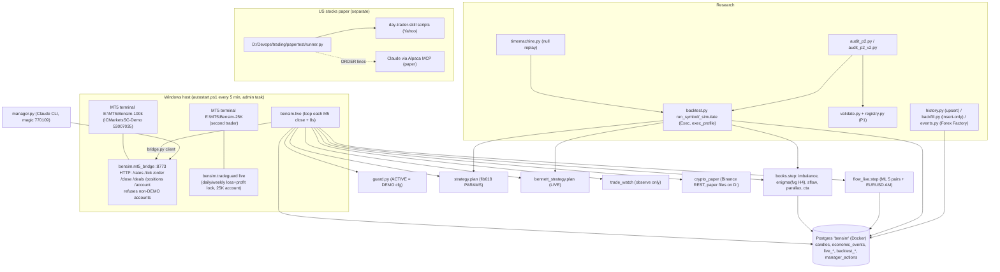

> Copied 2026-11-03 from the Claude scratchpad, unchanged. Later corrections are logged in docs/audit/CORRECTIONS_2026-11-03.md.

# BENSIM: complete system audit (read-only, 2026-11-03)

**Scope and method.** I read the source and the existing reports, ran read-only SQL on the `bensim` database, read the running process list, and loaded the existing data files read-only.
- **No** backtests, experiments or tests were run for this audit.
- No order, configuration or strategy was changed.
- The paper session was left running but I place **no** orders for it.
- The R1/R2 trade-generation job (started earlier today) was **stopped before it wrote any output**.
- This file sits in the Claude scratchpad, not the repo. Copying it into the repo is your call.

**Confidence labels.** **H** = verified in code and/or data in this audit. **M** = verified in code but not exercised. **L** = taken from documentation or earlier-session notes and not re-verified. **UNKNOWN** = couldn't be established.

**Corrections to my own earlier work today** (details in §12):
- (a) I said the live research books (imbalance, enigma) hold weekends. **Wrong:** `live.close_all` closes every bensim book on Friday at 20:00 UTC.
- (b) The R1/R2 and P3 pre-registrations say "USDCAD before 2024-02 = Dukascopy fill". **Wrong:** there is **no** USDCAD M5 data before 2024-02-06.
- (c) My cost snapshot tried the wrong MT5 terminal.

---

## 1. Executive summary

**What Bensim is today (H).** A Python forex trading system on one IC Markets **demo** account (login 53007035, `ICMarketsSC-Demo`, ~$98.8k equity). `bensim/live.py` runs every M5 close (~8 s after) and trades **seven books** with real demo orders:

| Book | Magic | Status |
|---|---|---|
| fib618 | 770101 | main strategy |
| Bennett | 770102 | |
| flow ML + EURUSD morning short | 770103 | |
| imbalance | 770104 | research book |
| enigma | 770105 | research book |
| sflow | 770106 | research book |
| parallax | 770107 | research book |
| cta | 770108 | research book |
| Claude "manager" hand | 770109 | discretionary |

It also runs a crypto **paper** book (no orders) inside the same loop. A separate `tradeguard` process watches a second trader's 25K account.

**Backtesting (H).** One shared engine, `bensim/backtest.py`. Strategies are pure `plan()` functions that live and backtest share. That's a strong design, and lookahead control is good: windows are cut at completed bars, a bar touching both stop and target counts as the stop, and gaps fill at the open. **But** the historical record has five systematic mismatches with live:
1. **Before 2026-11-03, no backtest closed on Friday.** Live closes all books at Friday 20:00 UTC.
2. **No swap was charged.**
3. **Spreads and commission were a raw-account guess.** The live account actually charges ~0.8–1.0 pip spread and $0 commission. The totals happen to be similar in liquid hours.
4. **Each strategy is backtested alone.** Live shares one pair-slot across all books (one trade per pair), with fib618 getting first choice.
5. **Research symbol sets differ from the live ones** (§6).

So the backtest is trustworthy for **lookahead and fills**, but **not** as a reproduction of the live portfolio.

**Statistically established (H, from P2 and earlier long-run tests):**
- **No strategy has a statistically significant positive edge.**
  - Over the last 3 months, DSR (Deflated Sharpe Ratio) ≈ 0 for every strategy with n ≥ 20.
  - PBO (Probability of Backtest Overfitting) is 0.41–0.50.
  - The long-run tests on file are negative or flat: fib618 −0.048R on 25 pairs × 14y; imbalance 5y t = 0.96.
- **Significant results exist only on the losing side:**
  - orderflow, significantly negative: 11/11 losers, Holm-adjusted p = 0.0096;
  - pullback, negative over 1,065 trades (t −2.6).

**What's unknown:**
- the live realized P&L per book (not read in this audit);
- whether any condition-dependent edge exists;
- costs outside the one sampled hour;
- the swap history.

---

## 2. Architecture

### Component map (file → what it does → used?)
| Component | Path / main symbols | Does | Called by | Depends on | Used |
|---|---|---|---|---|---|
| Live engine | `bensim/live.py` `cycle` L185, `decide` L305, `decide_bn` L280, `close_all` L142, `shadow` L151, `main` L381 | every M5 close: guard, Friday close, time exits, fib618 + Bennett signals → orders; then flow, books, crypto paper | `start_live.ps1` watchdog (autostart) | bridge, guard, strategy, bennett_strategy, books, flow_live, crypto_paper, trade_watch, db | **yes**, PID 14600, started 2026-11-01 15:05 UTC (H) |
| MT5 bridge | `bensim/mt5_bridge.py` `make_handler` L71, `_market` L50 | HTTP wrapper on MetaTrader5. Market orders deviation 20 points, FOK/IOC/RETURN filling; refuses non-DEMO | `start_bridge.ps1` (MT5_PATH=E:\MT5\Bensim-100k) | MetaTrader5 pkg | **yes**, PID 7632 |
| Bridge client | `bensim/bridge.py` `rates/tick/order/close/deals/positions` | fail-closed HTTP client | live, books, flow, manager, history, backfill | config (key) | yes |
| Risk guard | `bensim/guard.py` `check` L58, `risk_scale` L53, `flatten_now` L49 | per-order: flatten, drawdown halt, max open, **symbol already open**, currency-side cap, worst-case daily risk | live.decide, books._send, flow, manager | — | yes, **DEMO cfg** (§12) |
| Books | `bensim/books.py` `step` L246, `pick` L82, `_send` L217, `_exits` L188, `touched` L62 | 5 research books, one trade per pair, highest-confirmation wins, time exits, cta trail | live.cycle L271 | strategy, fvg_strategy, sflow, parallax, cta_momentum (**untracked file**) | yes |
| Flow book | `bensim/flow_live.py` `step` L181 | ML (rate-aware, 5 seeds) on EURUSD/USDJPY/USDCAD/EURJPY/CADJPY, 0.8 lots, 6 h; EURUSD short 09:00→12:00 UTC 2.5 lots; disaster stops | live.cycle L267 | macro_yields, edge_miner, data/flow_models | yes (`BENSIM_FLOW` default live) |
| Manager | `bensim/manager.py` | Claude's discretionary trades/closes, 0.25 %, max 2, logged and scored | manual CLI | bridge, guard | yes (1 open, 7 closes) |
| Trade watch | `bensim/trade_watch.py` | observe-only verdicts per open trade | live.cycle L205 | strategy.trend | yes |
| Crypto paper | `bensim/crypto_paper.py` `step` L47 | daily momentum rebalance, virtual $100k | live.cycle L275 | Binance public REST | yes (no orders) |
| TradeGuard | `bensim/tradeguard.py` `live` L129 | locks a second account on day/week loss/profit | `start_tradeguard.ps1` | MT5 (25K terminal) | yes, PID 35656 |
| Backtester | `bensim/backtest.py` `run_symbol` L137, `_simulate` L184, `Exec`, `exec_profile`, `friday_close_ts` | M5-bar engine for all `plan()` strategies | research scripts, books (Exec/_spread), live (`_win`, `resample`) | db, strategies | yes |
| Strategies | `strategy.py` (fib618, imbalance), `fvg_strategy.py` (enigma / H1 FVG), `bennett_strategy.py`+`bennett_smc.py`, `pullback_strategy.py`, `orderflow_strategy.py`, `gf_strategy.py`, `sflow.py`, `parallax.py`, `cta_momentum.py`, `phantom.py`, `crypto_momentum.py`, `tsmom.py` | signal/plan logic | live/books/backtest/research | indicators.py (LuxAlgo-style) | see §3 |
| Time Machine | `bensim/timemachine.py` `blocks` L32, `bars_by_slot` L48, `replay` L66, `run` L120 | null-model replays | tm_check, r2_noise (not run), manual CLI | backtest.load_m5, Exec | research only |
| Validation | `bensim/validate.py` `report`, `psr`, `dsr_threshold`, `block_bootstrap`, `pbo_cscv`, `holm` | statistics on trade CSVs | audit_p2, audit_p2_v2 | registry | research (P1) |
| Registry | `bensim/registry.py`, `data/experiments/registry.jsonl` (368 lines) | append-only experiment log | audit scripts | git, db | research (P1) |
| Data | `history.py` (upsert), `backfill.py` (insert-only), `events.py` (Forex Factory), `fxcm_history.py`, `binance_history.py`, `macro_yields.py` | ingestion | manual | bridge, web | yes (manual) |
| Paper (stocks) | `D:/Devops/trading/papertest/runner.py` (running, PID 47584); `runner_next.py` + `account.py` + `test_runner_next.py` (**not deployed**) | day-trader-skill chain on 10 US stocks, ORDER lines for Claude to place on Alpaca paper | manual | Yahoo, plugin scripts | running; **no orders placed during this audit** |
| Claude skills | plugin `day-trader-skill` 2.0.0, **11** skills (scanner, news, entry, exit, timemachine, budget, risk, broker, alerts, analyst, pelosi) | US-stock tools, Yahoo/SEC data | runner.py | stdlib | not connected to Bensim forex (H) |
| Research-only modules (not used live) | phantom, pullback, orderflow, gf, edge_miner, signal_search, regime_*, gold_*, night_*, scalp_*, pattern_check, tm_check, walk_forward, meta, etc. | experiments | manual | — | inactive (H: not imported by live/books) |

---

## 3. Strategy breakdown (implemented behaviour, from code)

Shared conventions: bars are **bid**, UTC. `plan()` sees only completed M15/H1/M5 windows and returns TRIGGERED on the **first M5 close** that touches the entry. `order_for` turns that into a **market** order at the current bid/ask and refuses it if the price is outside stop/target or R:R > `max_rr` (strategy.py:353-364). Live sizing: `lots = initial_balance × RISK_PCT × scale / loss_per_lot` (live.py:116-123, 313-316).

### fib618 (live, magic 770101; confidence H)
| Question | Implemented answer |
|---|---|
| Behaviour exploited | breakout continuation: buy the 61.8 % pullback of a Donchian breakout leg |
| Instruments / TF | live: **EURUSD, GBPUSD, USDCHF, USDCAD, XAUUSD** (live.py:43; USDJPY and AUDUSD dropped 2026-10-13). Signal M15, H1 trend, M5 trigger |
| Data | M5 from MT5 (last 3,500 bars), resampled to M15/H1 (live.py:84-96) |
| Entry | M15 close beyond the 20-bar channel by ≥ 0.3 ATR14, ATR14/SMA50(ATR) ≥ 1.1, H1 swing trend agrees (strategy.py:234). Leg origin = channel extreme (237), leg end = extreme up to the **signal bar** (239). Entry = leg1 − 0.618 × leg (255). Market at the first M5 close touching it within 48 M15 bars (313-347) |
| Confirmation | ≥ 2 of (killzone 07-10 / 12-15 UTC, POI = FVG or OB at the zone, liquidity sweep) (strategy.py:281; indicators.py:32, 259) |
| HTF bias | H1 swing trend (strategy.trend) |
| Session | via the killzone confirmation (85 of 92 P2 trades in killzone, H) |
| News filter | **none live**. `Exec.news_block_min` exists for research only |
| Stop / target | stop = leg origin ∓ 0.1 ATR (256); target = **open of the next bar ± 4 ATR(signal)** (269). Rejected if stop < 8 × round-trip cost (273) or R:R > 20 |
| R:R | (target − fill) / (fill − stop) at the live quote (strategy.py:361) |
| Position size | 0.5 % of the **initial** balance; × 0.5 if only 2 of 3 confirmations (live.py:312-314); × guard.risk_scale |
| Management | fixed SL/TP at the broker, no partials or BE; `shadow` checks SL/TP/lots (live.py:151) |
| Max hold | 200 M15 bars = 50 h **wall-clock** live (live.py:209-215) vs **600 M5 bars** in the backtest (backtest.py:204) |
| Weekend | live: close all at Friday ≥ 20:00 UTC, no new orders then (live.py:198-199). Backtest: only with `friday_close_utc=20` (P0, 2026-11-03) |
| Duplicates | `live_signals` primary key (symbol, signal_time, dir) means never sent twice (live.py:227-232); guard SYMBOL_ALREADY_OPEN and CURRENCY_SIDE_FULL |
| Invalidation | 48-bar expiry; the touching M5 bar also hitting the stop = no trade (strategy.py:339-345) |
| Known weaknesses | fragile far ATR target (R:R 2.1–13.6); fib frozen at the breakout; long-run negative (25 pairs × 14y −0.048R) |

### Bennett (live, magic 770102; H)
- **Pairs:** EURUSD, GBPUSD, USDJPY, USDCHF, USDCAD (bennett_strategy.py:119). Risk 0.5 % × 0.5.
- **Steps** (`plan` L217; LIVE params L116-118):
  - no Sunday (L231); killzones 07-11 / 13-17 (L233);
  - H4 structure agrees with the H1 leg; relief reaches the OTE 62–79 % (L270);
  - setup expires 48 h after the last push (L274); invalid on a close beyond the protected level;
  - M5 CHoCH on the newest bar; 30-min structure agrees (`agree_tf`);
  - target = liquidity ≥ 2.75R, max 2 candidates (L388); `clear_path`, no opposite untouched imbalance (L397).
- **Stop:** "tight" mode beyond the trigger structure + buffer (L361-367). **Hold:** the plan's own `hold_bars`, carried in the order comment `h<bars>` (live.py:211-212).
- **No partials/add-ons in LIVE:** `t1_partial` and `add_on` are False.
- **Frequency:** ~5 trades per 3 months on 6 symbols (funnel, §9).

### imbalance (live book 770104; H)
- `strategy.plan` with default `Params()`: the same Donchian signal as fib618.
- Entry at the base candle of the latest 3-candle-gap chain (strategy.py:248-253); stop = zone far edge − 0.1 ATR; target 4 ATR.
- No confirmations. Book sizing 0.5 % × 0.5 = 0.25 %. **7 live symbols** (books.SYMBOLS includes AUDUSD and USDJPY).
- Weekend: **closed Friday 20:00** by live.close_all (live.py:143).

### enigma (live book 770105) and H1 FVG (research only); H
- `fvg_strategy.plan` (L105): an open LuxAlgo FVG on H4 (enigma) or H1; M15 taps it within 16 bars; M15 MSS/BOS plus a displacement FVG.
- Entry at the FVG CE (L90). Stop beyond the leg. Target = nearest opposite liquidity ≥ 1.5R, else 2R (L95-96). Hold 200 M15.
- Live enigma: 0.25 %, 7 symbols, Friday close.

### pullback (research only; H)
- EMA20/50 side; close inside the band ± 1 ATR; H1 not against; market on the next M5. Stop 1.2 ATR, target 2.5 ATR (pullback_strategy.py:35-87).
- 3m P2: 1,065 trades, −0.117R.

### orderflow (research only; H)
- Faiz "liquidity OB": internal CHoCH, opposite-candle OB, a body fake-out above the OB, liquidity required.
- Limit near the OB, target = unswept pool ≥ 2R, else 3R (orderflow_strategy.py:59-63, 147-189).
- P2: 11/11 losers.

### gf (research only; H)
- D1 and 12H structure agree; 4H pullback, then a 4H CHoCH on a close; market on the next M5.
- Stop beyond the 4H pullback; target = the 12H leg extreme, min R:R 1. Hold 480 M15 (gf_strategy.py:30-85). P2: 2 trades.

### sflow (live book 770106; M)
- JeaFx structure (sflow.py docstring). Live entry "A": H1 close-only BOS gives a zone; limit at the near edge (books.sig_sflow L142).
- Killed by an M5 close beyond the far side, by a newer BOS, or after `WAIT_DAYS`.
- Stop = protected swing ∓ 0.1 ATR; target = the impulse extreme at the fill (≥ 1R, books._send L222-227); `HOLD_DAYS` hold.
- **No minimum stop distance in the live path:** a 1.3-pip stop with 19.39 lots AUDUSD was sent today (live_events, H).

### parallax (770107) and cta (770108), live books; M
- **Both run on D1 bars.**
  - **parallax:** BB + Stoch + indecision/engulfing; two limits at the 23.6/38.2 % retracements; stop 78.6 %; target −100 % extension; 5-day expiry, 30-day hold.
  - **cta:** with-trend bar after a 2-bar pullback; stop order 1 pip beyond it; trail under pullbacks (books.trail_update L96); 120-day hold.
- **The Friday close makes their multi-day/multi-week design impossible live.** live.close_all closes them every Friday, which **contradicts their backtested holding periods** (CONFIRMED mismatch, H).

### flow ML / EURUSD morning short (770103; M)
- **ML:** hourly 5-seed model on 5 pairs, threshold = 95th percentile of the previous year, **fixed 0.8 lots**, 6-hour exit.
- **AM:** sell EURUSD at 09:00 UTC, close from 12:00, **fixed 2.5 lots**.
- Disaster stops: 145 bp (ML), 68 bp (AM).
- **Not risk-scaled:** the AM worst case ≈ 2.5 × 100,000 × 0.0068 ≈ $1,700 ≈ 1.7 % of equity.

### manager (770109; M)
- Claude's discretionary trades: 0.25 %, max 2 open, guard applies, experiment stop at −5R.

### Other research engines
phantom, crypto_momentum/tsmom, optsim (options, separate package), gold_*, night_*: not live. crypto_momentum runs as the paper book (§2).

---

## 4. Trade lifecycle (fib618, actual code path)

1. **Bars.** `live.bars(sym)` → `bridge.rates(sym,"M5",1,3500)`, i.e. positions from 1 = completed bars only → `server_to_utc` (live.py:84-87). Stale guard: skip if the newest bar isn't the one that just closed (L218-223).
2. **Windows.** `live.windows()`: the same resample/`_win` as backtest.run_symbol (L90-96 vs backtest.py:162-166).
3. **Signal.** `strategy.plan(...)` → TRIGGERED dict with entry/stop/target/checks (strategy.py:346).
4. **De-dup.** Insert into `live_signals` (`on conflict do nothing`); repeats are skipped (L227-232).
5. **Quote + order spec.** `bridge.tick` → `order_for(pl, bid, ask)`; market price = ask for buys, bid for sells; refuse if outside the plan or R:R > 20 (strategy.py:353-364).
6. **Size.** Confirmations count → `confidence` 1.0 or 0.5; `risk_target = initial × 0.5 % × guard.risk_scale × confidence`; lots from the broker tick value/size, floored to the volume step (L116-123, 312-319).
7. **Risk checks.** `guard.check`: flatten, drawdown halt, max_open (DEMO 6), **symbol already open (any bensim magic 770101-770199)**, currency side (DEMO 99), worst-case daily risk (DEMO 10 %) (guard.py:58-75).
8. **Order.** `bridge.order` → `mt5_bridge._market`: TRADE_ACTION_DEAL at tick ask/bid, deviation 20 points, filling FOK/IOC/RETURN by symbol, SL/TP attached; ok only if retcode DONE. A rejection is logged ORDER_REJECTED; there is **no retry** (mt5_bridge.py:50-69, live.py:327-329).
9. **Fill.** The broker fills. Partial fills: **UNKNOWN**. IOC could part-fill; the engine records the requested lots, and `shadow` would WARN on a lots mismatch (L174-175).
10. **Management.** SL/TP sit at the broker. Engine: time exit (wall-clock), Friday 20:00 close_all, daily flatten; `trade_watch` observe-only.
11. **Exit/P&L.** Broker-side. No engine P&L ledger per strategy: P&L lives in MT5 deals (bridge /deals). `manager.score` scores manager trades.
12. **Logging.** `live_signals.detail` (price, sl, tp, lots, risk_usd, broker result), `live_events`, `live_state` heartbeat.

**Where live / paper / backtest can differ:**

| Item | Live (code) | Backtest (code) | Note |
|---|---|---|---|
| Bid/ask | real tick at order time (~8 s after the bar) | bar close bid + modelled spread (backtest.py:168-170) | entry slippage beyond 0.1 pip not modelled |
| Spread | real | legacy: raw 0.1–0.3 pip ×4 at 20:55-22:05 UTC; observed profile: 0.8–1.0 pip (one-hour sample) | **estimated** |
| Commission | demo account books **$0** (150 days of deals, H) | legacy $7/lot; observed profile $0 | for an FTMO/raw account it would differ (UNKNOWN) |
| Swap | broker charges | legacy none; observed profile per lot-night from deals, Wed ×3 | swap rates change over time (estimated) |
| Slippage | real | 0.1 pip on entry and stop exits (backtest.py:186-187, 226) | estimated |
| Partial fills / requotes | possible; no retry | none | UNKNOWN impact |
| Server time | MT5 server = UTC+2/+3 (US DST rule), `server_to_utc` | same conversion for history | verified by data (gold break shifts 20:55→21:55 after Nov 1), H |
| Candle vs intrabar | decision on completed M5; SL/TP intrabar at the broker | SL/TP checked on M5 high/low, both touched = stop | conservative |
| Time exit | wall-clock 50 h | 600 M5 bars | differs around holidays and data gaps |
| Friday | close all books 20:00 UTC | only if `friday_close_utc=20` | historical results before P0 held weekends |
| Portfolio | one trade per pair across all books, max 6 open | each strategy alone | live trades ⊂ backtest trades |

---

## 5. Backtesting forensic audit

**Engines:**
- `bensim/backtest.py` (main, all `plan()` strategies);
- separate simulators inside `sflow.py`, `parallax.py`, `cta_momentum.py`, `phantom.py`, `crypto_momentum.py`;
- `optsim/` for options.

This audit inspected the main engine in detail; the others only at docstring level (M/L).

**Data used by backtest.py (H):**
- DB `candles` M5 bid (IC Markets MT5): EURUSD 2018-10 → 2026-11-03; GBPUSD, USDJPY, USDCHF, AUDUSD, XAUUSD 2021-10 → 2026-11-03.
- **USDCAD only from 2024-02-06** (Dukascopy fill to 2024-12-31, then IC Markets).
- Binance npz for crypto.
- **Not used:** FXCM M5 2012-2026 with spreads (`data/bars/fxcm/*_M5.npz`, 25 pairs).

| Check | Verdict | Evidence |
|---|---|---|
| Indicators only use the past | **VERIFIED CORRECT** | windows cut by bar end ≤ now (backtest.py:162-166); Donchian `shift(1)` (strategy.py:210-211); H1 index from `known` (L231-232) |
| Repaint / future candles | **VERIFIED CORRECT** for plan(). M5 trigger uses the forming M15's completed M5 bars only (strategy.py:226, 332) | code |
| Entry price realism | **POSSIBLE RISK** | market at the trigger bar's close + modelled spread, no latency |
| Spread by instrument and time | **POSSIBLE RISK** | per-symbol constant + rollover ×4 only (backtest.py:79-84); the docstring claimed an hour profile (fixed in the P0 docstring) |
| Slippage | estimated 0.1 pip | backtest.py:59 |
| Commission/swap | legacy: commission yes, swap **no**. P0 adds swap (default off) | backtest.py |
| Triple swap / weekends | P0: Wednesday ×3, Sat/Sun 0 (`mt5_time.rollover_nights`, tested) | test in this session (earlier) |
| Overlapping trades | one trade per strategy per symbol (`open_until`, L153, 179). **VERIFIED CORRECT** | code |
| Capital reuse | R-based; P&L = fixed fraction of the **start** balance, no compounding (`summarize` L263-270) | **POSSIBLE RISK** for $ claims, fine for R |
| Equity-based sizing | not modelled (live uses the initial balance × scale too, so it's consistent) | — |
| Floating drawdown | **not** included (closed-trade equity only, `summarize`) | POSSIBLE RISK vs FTMO's daily equity rule |
| Reproduces live rules | **CONFIRMED MISMATCH**: Friday close (pre-P0), symbol sets, portfolio rules, books' D1 holds vs the Friday close, wall-clock hold | §6 |
| Lookahead in fills | **VERIFIED CORRECT**: exits checked from bar k+1 (L206) | code |
| Both stop and target in one bar | **VERIFIED CORRECT** (stop first) | L222-231 |
| Gaps through the stop | **VERIFIED CORRECT** (fill at the open, worse) | L224-226 |
| Time zone | **VERIFIED CORRECT** for history (`server_to_utc`) | mt5_time.py + data |
| Duplicate trades | none within a strategy/symbol; across strategies they **can** duplicate (fib618 and enigma took the same Sep 9 trade) | P2 data, H |
| Missing bars | not detected inside the backtest; reported by `history.audit` / `backfill` (data_audit table: holes > 2 h per symbol, e.g. XAUUSD 56) | DB |
| Survivorship | n/a for FX majors; **selection bias YES**: symbols dropped after negative results (live.py:42) | code comment |
| Overfitting | **HIGH risk**: 368 registry trials; live config chosen on the Jul–Oct 2026 window | registry |
| Limit orders (Bennett add-on) | limit fills checked before the stop in the same bar ("conservative" comment, L210-211). Questionable: could be optimistic. POSSIBLE RISK (off in LIVE) | code |

**Tests that exist (not run in this audit):**
- `test_backtest.py`, `test_live.py` (5 passed, earlier today).
- `test_backtest_p0.py` (1 passed). `test_timemachine.py` (4 passed).
- `test_parallax.py`, `test_cta_momentum.py`, `test_flow_live.py` (status UNKNOWN in this audit).

---

## 6. Live / paper / backtest consistency

| Behaviour | Live | Paper (stocks) | Backtest | Consistent? |
|---|---|---|---|---|
| Entry rules (fib618, Bennett, imbalance, enigma) | `plan()` on live MT5 bars | n/a (different system) | same `plan()` | **yes** (same code, H) |
| sflow / parallax / cta entries | books.py's own fill logic (`touched`) | n/a | their own simulators | **partly**: rules re-implemented, not shared (M) |
| Symbols: fib618 | EURUSD GBPUSD USDCHF USDCAD XAUUSD | — | research runs used 6–7 incl. USDJPY/AUDUSD | **no** |
| Symbols: Bennett | 5 FX (no XAU) | — | P2 included XAU | **no** (P2) |
| Symbols: books | 7 incl. AUDUSD | — | P2 6 (no AUDUSD) | **no** (P2) |
| Sizing | 0.5 % initial × scale (fib618 2-of-3 → 0.25 %); Bennett 0.25 %; books 0.25 %; flow fixed lots | Alpaca paper: day-trader budget, $50k max order; **fresh $100k per order** (bug) | R units; $ at 0.25 % start balance | **no** for flow (fixed lots); R-consistent otherwise |
| Costs | real | Alpaca paper | legacy guess or observed profile | estimated |
| SL/TP | at the broker, fixed | bracket at Alpaca (Claude-placed) | M5 high/low, stop first | yes |
| Management | none (trade_watch observe) | none | none | yes |
| Friday / weekend | **all bensim books closed Fri 20:00 UTC** | flat 15:55 ET daily | pre-P0: weekends held; P0 option per run | **no** historically |
| Max open | 6 (DEMO guard) | 3 trades/day | unlimited across strategies | **no** |
| One trade per pair | guard + books.pick across all magics | — | per strategy only | **no** |
| Currency exposure | DEMO max_per_side 99 = effectively off | — | none | effectively both off |
| Account limits | DEMO: 10 % daily stop/flatten, no DD brake | day-trader risk caps | `summarize` reports FTMO breaches only | **no** |

**Mismatches that could invalidate historical performance:**
- the weekend holds;
- the absent swap;
- portfolio interaction: live drops trades the backtest takes;
- symbol-set differences;
- D1 books (parallax, cta) being force-closed every Friday although their edge, if any, needs multi-week holds.

---

## 7. Time Machine

**Code (H):** `bensim/timemachine.py`.

**Default "bensim" mode** (`run`, repo=False):
- **Pool:** the 26 weeks of M5 before t0, cut into 1-hour blocks of 12 bars keyed by hour-of-week. Each bar is stored as o/h/l/c over the previous close. **Each hour's mean drift is divided out** (`blocks` L32-45).
- **Replay** (L66-102): from the entry price, each following hour draws a random past block of the same hour-of-week. Long exits on bid, short on bid + `_spread`. A bar touching both = stop. It runs to the Friday 20:00 close (`friday_close` L60), or to `until` when called directly.
- **Outputs:** P(target first), P(stop first), P(open), P(stop within 1 h), mean R (open trades marked at the end price).
- **The verdict** compares the target share among replays that hit a side with the break-even 1/(1+R) (L105-117).

**"Repo" mode** (`bars_by_slot` L48): 60 days, single 5-min bars by time of day ± 2 slots, **drift kept**.

**What it is:**
- The bensim mode is a **null (noise) model**: direction and serial memory are removed by construction (stated in the docstring, H). It can't predict direction. It gives the hit odds for a given stop/target geometry under shuffled noise.
- The repo mode keeps the mean drift, so it acts as a **60-day momentum indicator**.

**Findings on file:**
1. **Repo split** (tm_check Jul 26–Oct 26 2026, 155 trades): favoured −0.20R vs opposed +0.73R.
   - Favoured agrees with "with the 60-day trend" in **74 %** of trades (computed today from `logs/tm_check_2026-07-26_fx.csv` plus DB closes, H).
   - The result is concentrated in GBPUSD and 3 weeks.
   - Day-clustered t ≈ 2.07 after ≥ 6 splits, so it isn't significant (H).
2. **Bensim-mode TM vs outcome** (same 155 trades):
   - AUC 0.559 for wins; reward:risk alone gives 1/(1+RR) AUC 0.586.
   - Correlation with 1/(1+RR) 0.55.
   - **Partial correlation with R, after accounting for log RR: 0.078, t 0.96** (computed today, H).
   - Calibration: the real target-hit rate exceeds the TM rate by 7–15 points in every quartile (in-sample, plus a horizon mismatch).
3. **A 10 % target-first refusal gate** was tested on Oct 29 and **failed**; it was removed (memory log, L).

**What it can establish:** the noise-only hit rate and expected R for a given geometry, holding time and spread. That makes it a fair **baseline** (excess-over-noise).

**What it can't establish:** a forecast of a single trade. Edge, or whether a market condition is favourable, can't be read from its numbers alone.

R2 (strategy vs this baseline) is pre-registered and coded, but **not run**.

---

## 8. Statistical validation (as implemented in `bensim/validate.py`)

- **Expectancy:** mean net R per trade (`r` = gross after spread/slippage − commission + swap).
- **"Gross"** = `r_gross`: after spread and slippage, before commission and swap. A pre-spread gross isn't stored.
- **PF:** sum of winning R / |sum of losing R|.
- **Sharpe / Sortino:** on a **daily** series. R is summed by exit day over **every weekday** in the period (flat days = 0), × √252. Sortino uses the downside RMS over all days. A per-trade Sharpe = mean/sd is also reported.
- **PSR:** Φ((SR − SR*)·√(n−1) / √(1 − skew·SR + (kurt−1)/4·SR²)) on the **per-trade** SR, with raw kurtosis.
- **DSR:** PSR with SR* = √Var(trial SRs) × ((1−γ)Φ⁻¹(1−1/N) + γΦ⁻¹(1−1/(Ne))).
  - N = **all registry records** (368 now).
  - Var from the per-trade SR (t/√n) of registered runs with ≥ 30 trades.
  - Current SR* ≈ 0.44 per trade.
- **Effective sample size:** days × (1−ρ₁)/(1+ρ₁), from the lag-1 autocorrelation of daily R.
- **Block bootstrap:** circular, block ≈ n^(1/3) days, 5,000 paths, seed 19, on daily R → 90 % CI of total R, P(total ≤ 0), max-DD distribution.
- **Drawdown:** on cumulative R in exit order: max DD, peak→trough days, recovery days (or "not recovered"), longest time under water.
- **PBO:** CSCV over the strategies' daily R, 8 blocks, 70 splits. PBO = share of splits where the in-sample best has an out-of-sample rank ≤ median.
- **Holm:** step-down on two-sided p from the day-clustered t.
- **"Walk-forward":** fixed rules split by month (no refitting). It's a stability view, not a true walk-forward fit.
- **Regimes:** causal D1 labels from the days before entry. Trend if the 20-day efficiency ratio ≥ 0.30; high vol if ATR14 > its 250-day median.
- **Sessions:** entry hour UTC (Asia 0-7, London 7-12, overlap 12-16, NY 16-21, rollover 21-24).
- **Self-test:** `python -m bensim.validate --selftest` passed earlier today. Not re-run in this audit.

---

## 9. Verified P2 and forensic findings

**FACTS** (from files, H):
- **fib618 P2:** 92 trades, +26.5R. **The top 5 trades = 108 %** of the total: without the top 3 it's +4.7R, without the top 5 −2.2R.
- **The largest trade:** GBPUSD short entered 2026-09-09 11:30 UTC, R:R 13.57, exit target 2026-09-10 12:35 (+12.99R).
  - High-impact events that day: ECB rate decision 12:15, US PPI 12:30, ECB press conference 12:45 (DB `economic_events`).
- **Enigma took the same trade**, same symbol, side and entry bar: +9.99R.
- **September:** fib618 +21.3R of the +26.5R. EURUSD/GBPUSD shorts there: 10 trades, +26.4R.
- **fib618/enigma:** daily correlation 0.66; **0.17 after removing 3 days**. 6/24 enigma trades overlap fib618; those make +12.7R, the rest −4.2R.
- **Bennett funnel** (M15 boundaries, Aug 3–Nov 3, 6 symbols): 37,713 calls → 23 past the M5 CHoCH → 1 trigger (5 trades in the backtest).
- **One-trade-per-pair** (approximated): 36 of 201 trades blocked, 32 of them same-direction duplicates. Max DD 25.7R → 17.6R.
- **Live demo since Oct 13:** fib618 26 sent, 13 guard-skipped; Bennett 2; imbalance 9; enigma 4; sflow 8; cta 1; flow 25.

**STATISTICAL EVIDENCE (H):**
- P2: DSR ≈ 0 for all strategies with n ≥ 20; PBO 0.41 (v2) / 0.50 (v1).
- Holm: only orderflow is significant (negative).
- fib618 bootstrap P(total ≤ 0) = 0.066.
- Live-set one-per-pair portfolio P(total ≤ 0) = 0.049, DSR 0.

**INTERPRETATION:**
- The fib618 and enigma 3-month positives are mostly one news-driven, far-target trade taken by two strategies at once.
- The London/September "effects" are that event plus killzone selection by construction.

**HYPOTHESES** (untested):
- profit concentrated around high-impact news (R1);
- no excess over noise (R2);
- the one-per-pair rule cuts variance, not expectancy (R4).

**CORRECTION (H):**
- **P2 v2 used "weekends held" for imbalance and enigma, which is wrong for live.** With the live Friday close (P2 v1 observed profile): enigma 24 trades, +0.43R, PF 1.68, P(total ≤ 0) 0.21, which under the pre-registered rule is **"investigate", not "reject"**. Imbalance: +0.063R, PF 1.08, still "reject".
- **The P2 symbol sets aren't the live ones** (fib618 includes USDJPY, 10 trades −4.1R). So P2 is "common dataset", not "live reproduction".

---

## 10. Current operational status (2026-11-03 ~14:00 UTC)

| Item | Status | Evidence |
|---|---|---|
| **Live (demo) engine** | **RUNNING, trading** (`dry=False`), heartbeat 13:30 UTC, equity $98,773, 1 fib618/Bennett position open | DB live_state, process list |
| Live books | imbalance, enigma, sflow, parallax, cta **on** (risk ×0.5); flow **live** (ML 0.8 lots, AM 2.5 lots) | engine start log 2026-11-01 15:05 |
| Guard | **DEMO cfg** (10 % daily, no DD brake, max 6 open) unless `BENSIM_GUARD=ftmo` | guard.py:31-33; not set in .env |
| TradeGuard (25K) | running | PID 35656 |
| Paper (US stocks) | runner.py running, waiting for 09:50 ET; **no orders will be placed during this audit** (the earlier auto-placing authorization is suspended by your "do not place orders") | PID 47584 |
| runner_next (shared account) | **tested, not deployed** | papertest/test_runner_next.py |
| Backtester P0 options | **implemented, default OFF, uncommitted** (backtest.py, mt5_time.py modified) | git status |
| Backfill / cost snapshot | **run once** (DB to 2026-11-03 12:00; costs JSON) | data/audit, data/costs |
| Validation engine / registry | implemented (untracked), registry 368 lines | files |
| P2 v1 / v2 | **done**; v2 Friday rule for books **wrong** (above) | reports/experiments |
| Forensic review | done (documentation) | docs/audit/forensic_2026-11-03.md |
| P3 | **pre-registered only, not run**; contains the wrong USDCAD data statement | docs/audit/p3_preregistration_60d_contrarian.md |
| R1 / R2 | **pre-registered + coded (r12_trades.py, r1_news.py, r2_noise.py); r12 started and STOPPED before output**; no results | this session |
| timemachine.replay `ex` param | small code change (default unchanged), untracked file | — |
| Git | branch `crypto`; HEAD 6b1218c; live-imported `cta_momentum.py` is **untracked**; the running engine loaded its code on Nov 1 and will pick up the working-copy files at its next restart | git status |

---

## 11. Data quality

| Dataset | Instruments | TF | Range | Notes |
|---|---|---|---|---|
| DB candles (IC Markets MT5, bid) | EURUSD | M5 | 2018-10-07 → 2026-11-03 | data_audit: 16 holes > 2 h |
| | GBPUSD, USDJPY, USDCHF, AUDUSD | M5 | 2021-10-03 → 2026-11-03 | 11 holes > 2 h each |
| | XAUUSD | M5 | 2021-10-03 → 2026-11-03 | 56 holes (daily break), 59 missing days |
| | **USDCAD** | M5 | **2024-02-06 → 2026-11-03** (Dukascopy 2024-02-06 → 2024-12-31, IC Markets 2025+) | **nothing before 2024-02** |
| | USDSEK | M5 | 2025-01 → 2026-10-12 | |
| | DXY (synthetic) | M5 | 2025-10 → 2026-10-09 | |
| | 0 duplicates; no bad OHLC (2026-07+ check); broker gap 2026-10-27 21:30-21:50 on all FX | | | |
| FXCM (`data/bars/fxcm`) | 25 pairs | **M5 and H1, with spread** | 2012-01-02 → 2026-10-09 | **not wired into backtest.py** |
| ForexSB (`data/bars/forexsb`) | 5 symbols | M5 (2024-02+), M15 (2018+), M30 (2010+), with spread points | → 2026-10-09 | M5 = the USDCAD fill source |
| Binance | top 30 crypto | M5 / D1 | 2017+ | crypto only |
| Economic calendar (DB) | all FF currencies | events | 2021-09-26 → 2026-10-18, 24,937 rows, 4,115 high, 53 weeks/yr, 0 duplicates | NFP times correct UTC in DST (H) |
| Costs | spread | 5 samples, one session (2026-11-03) | | **not a history** |
| | swap | per lot-night from 150 days of deals | | current, not historical |
| | commission | $0 observed on the demo | | |

**What can't be answered with current data:**
- the true historical spread on the IC Markets feed, or spread during news (FXCM has a historical spread, but for a different broker);
- historical swap rates;
- actual live slippage per order. That needs deals vs signal price; the fields exist but weren't analysed;
- USDCAD before 2024 on the broker's own feed;
- Bennett on enough pairs (needs M5 for ~20 pairs; FXCM M5 could serve);
- news **outcomes** (actual vs forecast): FF actuals aren't verified as stored (UNKNOWN).

---

## 12. Confirmed bugs and potential risks

**CONFIRMED BUG / MISMATCH:**
1. **Historical backtests held weekends; live closes every bensim book at Friday 20:00 UTC** (live.py:142-145, 198-199 vs backtest pre-P0). In tm_check, weekend-held trades were +15.7R of +49.1R.
2. **Swap was never charged** in the backtests (68/155 tm_check trades were held overnight).
3. **My P2 v2 / forensic error:** imbalance and enigma were modelled as holding weekends. Live closes them. Enigma's verdict becomes "investigate".
4. **The pre-registration texts (P3, R1/R2) assume USDCAD data before 2024-02. It doesn't exist.**
5. **`cost_snapshot.swap_rates` uses `.env` MT5_PATH (`C:\Program Files\MetaTrader 5`).** The bridge's terminal is `E:\MT5\Bensim-100k` (start_bridge.ps1:3). Wrong terminal, hence the IPC timeout. No stray terminal was left (process list).
6. **D1 books (parallax 30-day hold, cta 120-day trail) are force-closed every Friday live.** Their backtested design can't happen live.
7. **Paper runner (stocks): every order is sized/checked against a fresh $100k.** On Oct 15 data, $123k of positions on a $100k budget. Fixed in `runner_next.py`, **not deployed**.
8. **Live-imported code is untracked** (`cta_momentum.py`) and the working copy is dirty, so the version of the code that traded can't be reproduced from git.

**POSSIBLE RISK:**
- **Guard in DEMO mode:** 10 % daily, no drawdown brake, currency cap off. The docstring/FTMO rules are inactive.
- **flow book uses fixed lots,** about 1.7 % worst-case on AM, not risk-scaled.
- **sflow sends very tight stops** (1.3 pips, 19.39 lots). A minimum stop vs spread isn't visible in the live sflow path (M).
- **Spread is constant per symbol**; one-hour observation only.
- **Wall-clock vs bar-count time exits.**
- **Bennett add-on limit is filled before the stop in the same bar** (off in LIVE).
- **No floating-equity drawdown** in the backtest summary.
- **Selection bias** in the symbol lists; **overfitting risk** with 368 trials.
- **No retry/requote handling;** partial-fill handling UNKNOWN.

**VERIFIED CORRECT:** completed-bar windows; Donchian shift; stop-first rule; gap fills; one trade per strategy per symbol; server→UTC; de-dup of live signals; P0 options default-off (regression identical, earlier today).

**UNKNOWN:**
- live realized P&L per book and its match to the backtest (deals by magic not analysed);
- partial fills;
- `test_parallax` / `test_cta_momentum` / `test_flow_live` status;
- whether FF "actual" values are stored.

---

## 13. Missing capabilities

| Capability | Exists? | Why it matters |
|---|---|---|
| Regime classifier | **no reliable one.** Ad-hoc D1 efficiency/ATR labels in validate.py; studies found nothing monotonic | needed for any condition→strategy selection |
| Historical economic calendar | **yes** (FF 2021-09 → 2026-10, UTC-correct) | enables news-aware research (R1) |
| News-aware trade analysis | coded (r1_news.py), **not run** | the main explanation candidate for the 3-month positives |
| Volatility classification | partial (ATR expansion in fib618; validate's vol label) | |
| Liquidity/session analysis | killzones, LuxAlgo pools as rules; no evaluation framework | |
| Currency exposure | guard legs (off in DEMO); P2 v2 exposure report | portfolio risk is concentrated in USD |
| Market structure | yes (indicators.py, bennett_smc.py, sflow) | |
| Strategy-independent signal evaluation | **no** (each study is bespoke) | needed to separate edge from geometry |
| Fair noise baseline | **yes** (TM bensim mode); R2 not run | |
| Genuine OOS process | **partly**: registry + pre-registration now exist; datasets were reused heavily before | |
| TRADE / WAIT decision engine | **no**: everything that is coded trades when its rule fires | the stated objective |
| Live vs backtest reconciliation (per-trade) | **no** (shadow checks SL/TP/lots only) | can't tell if live ≈ backtest |
| Long M5 history with spread | **on disk (FXCM 2012-26) but not wired in** | biggest cheap data win |

---

## 14. Recommended next research priorities (proposals; nothing done)

1. **Live/backtest reconciliation.** Replay the backtest over Oct 13 → now with the live symbols, live Friday rule, one-per-pair across books and DEMO guard. Compare trade by trade with `live_signals` / `live_books` / MT5 deals. This says whether any backtest number describes what the account does.
2. **Wire FXCM M5 (2012-2026, 25 pairs, with spread) into `load_m5`** as a separate source. This gives the first long, multi-pair, spread-aware validation set and makes Bennett and R1/R2 statistically feasible.
3. **Fix the pre-registrations** (USDCAD coverage; P2 v2 book Friday rule), then run R1/R2 on the corrected datasets if you approve.
4. **Decide the live risk policy:**
   - DEMO vs FTMO guard;
   - flow fixed lots;
   - sflow minimum stop;
   - D1 books under the Friday close.

   These are operating decisions, not research.
5. **Commit or snapshot the exact live code** (and record a code hash in `live_state` at engine start) so every live trade can be tied to its code version.

## 15. Questions that need your decision
1. **Paper session today:** the runner will emit orders from 09:50 ET. Keep it running without placing orders, place them as authorized earlier, or stop the runner?
2. Should the D1 books (parallax, cta) keep trading live under a Friday close that breaks their design?
3. Guard mode: keep DEMO (10 %), or switch to the FTMO settings?
4. Flow AM at a fixed 2.5 lots (≈ 1.7 % worst case): keep, or scale to risk?
5. Approve priority 1 (reconciliation, read-mostly) and priority 2 (FXCM M5 wiring) as the next work?
6. Should this report and the corrected pre-registrations be copied into the repo (`docs/audit/`)?
